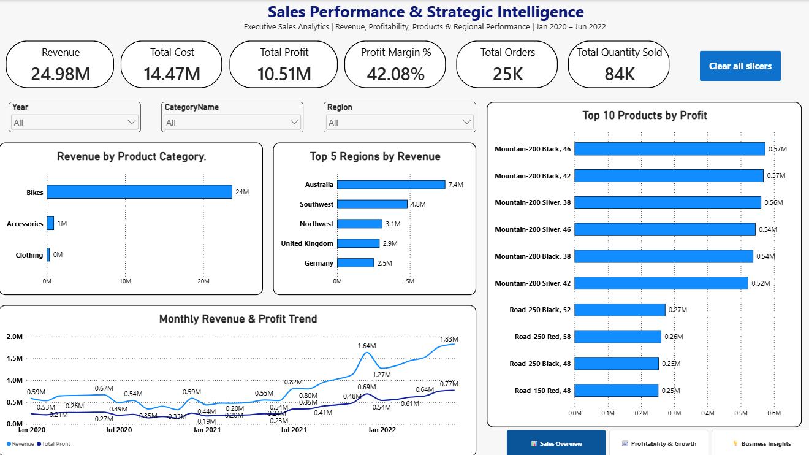
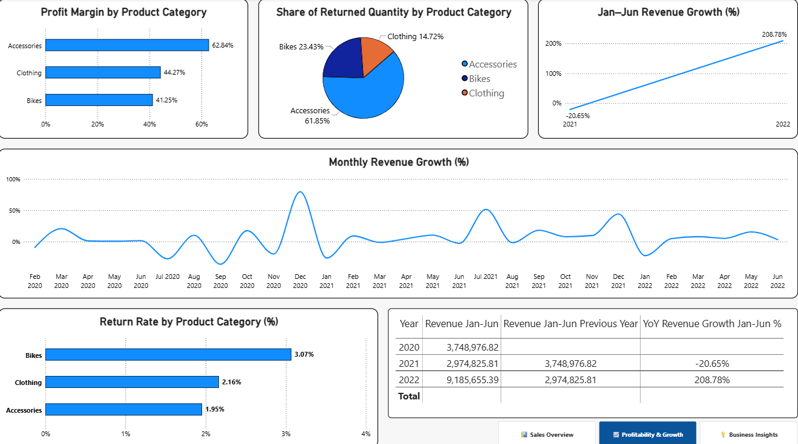
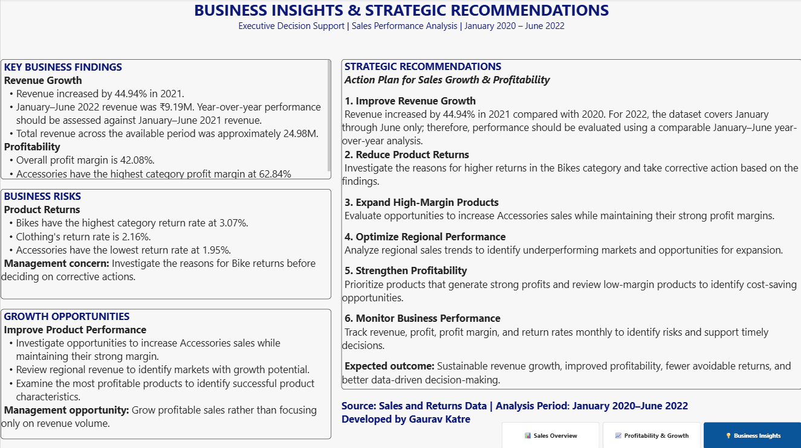

# 📊 Sales Performance & Strategic Intelligence Dashboard

An interactive **Microsoft Power BI Dashboard** analysing sales performance, profitability, products, regions, and returns from **January 2020 to June 2022**.

**Created by:** Gaurav Katre  
**Recognition:** Databuzz Power BI Challenge Top Performer – October 2026

---

## 📸 Dashboard Preview

### 1. Sales Overview



### 2. Profitability & Growth



### 3. Business Insights



---

## 🎯 Project Objectives

- Analyse overall sales revenue, cost, and profit.
- Evaluate profitability across product categories.
- Identify top-performing products and sales regions.
- Analyse product returns and return rates.
- Compare year-over-year sales performance.
- Convert raw sales data into meaningful business insights.
- Provide strategic recommendations to support business decisions.

## 📈 Key Performance Indicators

| KPI | Value |
|---|---:|
| Total Revenue | 24.98M |
| Total Cost | 14.47M |
| Total Profit | 10.51M |
| Profit Margin | 42.08% |
| Total Orders | 25K |
| Total Quantity Sold | 84K |

*Revenue is calculated using order quantity × product price. Total cost is calculated using order quantity × product cost from the product lookup. These calculated values may differ from actual transaction values if discounts or transaction-level adjustments are not included.*

## 🛠️ Tools & Technologies

- Microsoft Power BI
- Power Query
- DAX
- Data Modelling
- Data Cleaning and Transformation
- Data Visualization
- Business Intelligence

## 📑 Dashboard Pages

### Page 1: Sales Overview
- KPI cards for revenue, cost, profit, and orders.
- Revenue by product category.
- Top five regions by revenue.
- Top ten products by profit.
- Monthly revenue and profit trends.
- Interactive Year, Category, and Region slicers.

### Page 2: Profitability & Growth
- Profit margin by product category.
- Share of returned quantity by category.
- Monthly revenue growth.
- January–June year-over-year revenue comparison.
- Return rate by product category.

### Page 3: Business Insights
- Key business findings.
- Business risks and opportunities.
- Strategic recommendations.
- Action plan for improving sales and profitability.

## 🔍 Key Business Insights

1. Total revenue across the available period is approximately 24.98M.
2. Overall profit margin is 42.08%.
3. Revenue increased by 44.94% in 2021 compared with 2020.
4. Australia is the highest-revenue region in the displayed top-five regional comparison.
5. Accessories have the highest category profit margin at 62.84%.
6. Bikes have the highest category return rate at 3.07%.

**Growth comparison:** The dashboard reports 208.78% January–June revenue growth for 2022 compared with 2021. This unusually large result should be validated against source records, product prices, date filters, relationships, and DAX calculations before being interpreted as a confirmed business trend.

## 💡 Strategic Recommendations

- Investigate the reasons behind higher returns in the Bikes category.
- Explore opportunities to increase Accessories sales while maintaining profitability.
- Analyse regional performance to identify growth opportunities.
- Monitor revenue, profit, profit margin, and return rates regularly.
- Use comparable periods when evaluating year-over-year performance.

## 📂 Repository Structure

```text
Power-BI-Sales-Analytics-Dashboard/
│
├── Gaurav_Katre_Sales_Dashboard.pbix
├── Gaurav_Katre_Insights_and_Methodology.txt
├── README.md
│
└── Screenshots/
    ├── Sales_Overview.png
    ├── Profitability_and_Growth.png
    └── Business_Insights.png
```

## 🚀 How to Use

1. Download the `.pbix` file from this repository.
2. Open it using Microsoft Power BI Desktop.
3. Explore the three dashboard pages.
4. Use the interactive slicers to analyse different years, categories, and regions.

## 🏆 Achievement

Recognised as:

**Power BI Challenge Top Performer – October 2026**

Databuzz Power BI Contests

This recognition followed 15 days of dedicated work, learning, data analysis, and dashboard development.

## 👨‍💻 Author

**Gaurav Katre**

Aspiring Data Analyst | Business Intelligence Enthusiast

---

⭐ If you find this project useful, feel free to explore the repository and share your feedback.

**Thank you for visiting!**
